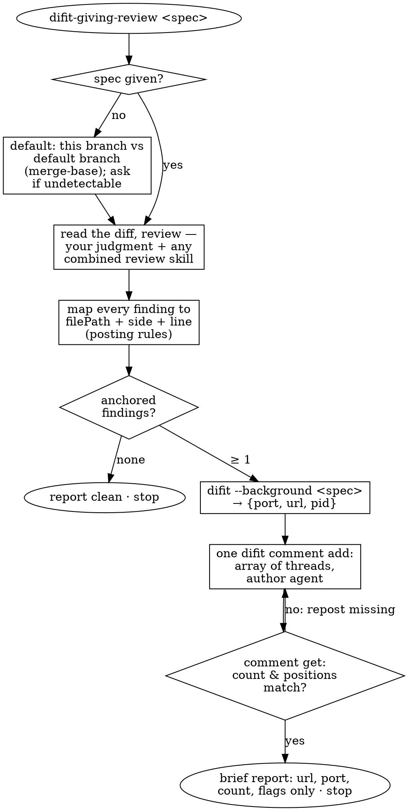

Work a code review and deliver its comments as threads in a [difit](https://github.com/yoshiko-pg/difit) (available in PATH) session that this skill launches. This skill owns where the feedback lands, not how to review: review the diff following your own judgment and any other review instructions combined with this skill. One invocation runs one review pass; when the user later answers in the threads, `difit-receiving-review <port>` picks the discussion up.



## Pass

1. **Take the diff spec.** The argument uses difit's own convention — `commit-ish`, `commit-ish compare-with`, `working`, `staged`, `.`, or a GitHub PR URL. With no spec, review this branch against the default branch: detect it via `git symbolic-ref refs/remotes/origin/HEAD`, else `main`/`master` if one exists; undetectable → ask the user. Read the diff locally with the equivalent command:

   | spec | read with | launch with |
   |---|---|---|
   | *(none)* | `git diff <default>...HEAD` | `difit --background --merge-base <default>` |
   | `X Y` | `git diff Y X` | `difit --background X Y` |
   | `X` | `git diff X^ X` | `difit --background X` |
   | `working` / `.` | `git diff` / `git diff HEAD`, plus untracked files via `git status` | append `--include-untracked` |
   | `staged` | `git diff --cached` | `difit --background staged` |
   | PR URL | `gh pr diff <url>` | `difit --background --pr <url>` |

   Done when you hold the full diff text for exactly what difit will display.

2. **Review the diff.** What to look for and how deep is not this skill's business — your judgment, or the combined review skill's. The format for every finding you keep: one thread per finding, anchored to the exact line that carries it; the body states the observation, why it matters, and a suggested direction. A finding with no anchorable line (whole-design remarks, test strategy, repo-level concerns) is a chat flag, never a thread.

   Done when every finding has `filePath`, `side`, `line`, and `body` — or is parked as a flag.

3. **Zero findings → report clean and stop.** No server is launched for an empty review.

4. **Launch difit** with the launch command from the table; it prints `{"port": N, "url": ..., "pid": ...}`. Background mode already implies `--no-open` and keep-alive — the browser opens when the user clicks the url in your report. Each pass launches its own server and lets difit pick the port; a difit that is already running (say, one whose threads `difit-receiving-review` is working) stays untouched.

5. **Post every thread in one call** (posting rules below), then verify:

   ```bash
   difit comment get --port <N> --format json
   ```

   Thread count matches your findings and every position is where you intended. difit deduplicates silently, so reposting anything missing is safe.

6. **Report briefly.** Short prose in chat: the url, the port (the user re-enters the discussion with `difit-receiving-review <port>`), the thread count, and flags only — the threads are the record. Then stop.

## Posting threads

One `difit comment add` carries the whole review — it accepts an array:

```bash
difit comment add --port <N> '[
  {"type":"thread","filePath":"src/a.ts","position":{"side":"new","line":42},
   "body":"<observation, why it matters, suggested direction>","author":"agent"},
  {"type":"thread","filePath":"src/b.ts","position":{"side":"old","line":{"start":10,"end":12}},
   "body":"<...>","author":"agent"}
]'
```

`position` uses file line numbers on one side of the diff, GitHub-style:

- `side: "new"` — the line's number in the new version of the file: added or modified code. Read it from the file itself, or `git show <target>:<path>` when reviewing committed specs.
- `side: "old"` — the line's number in the old version: deleted code (`git show <base>:<path>`).
- `line` is a single number or a `{start,end}` range on that side.

difit does not validate positions: a line outside the rendered diff is stored but floats without an anchor, silently. Anchor to the changed line itself wherever possible, and check every position against the diff you reviewed before posting.

## Rules

- This skill reviews — it changes no code. Fixes are the receiving side's job.
- Every thread carries `author: "agent"`; the sibling skill's resume logic reads that marker.
- The user resolves threads in the difit UI. You never run `difit comment resolve`.
- One invocation = one pass, ending at the report. Answers arrive in the threads; `difit-receiving-review` handles them.
- Servers this skill launches are never stopped or reused: no `--port`, no killing, no `--clean`.
