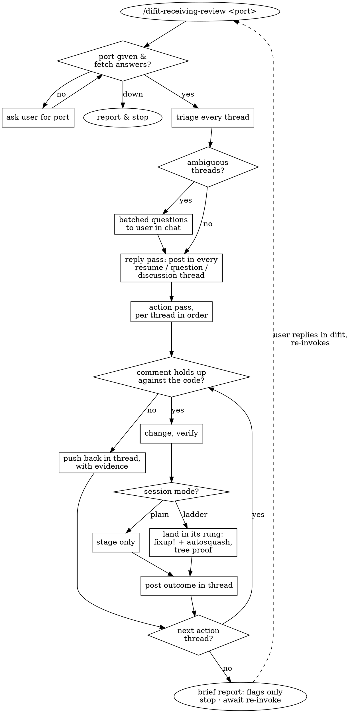

Work code-review comments left in a running difit (available in PATH) session. One invocation runs one pass; the user re-invokes to resume discussions and pick up new comments. A `difit --ladder` session (a review ladder, followed by its branch) lands each fix inside the rung it belongs to; any other session leaves fixes staged.



## Pass

1. **Take the port.** The user invokes this skill with the difit server's port. Missing or wrong port → ask the user for it. Verify by fetching:

   ```bash
   difit comment get --port <N> --format json
   ```

   Fetch fails → the port is wrong or the server is down; tell the user and stop. The response's `mode` decides how fixes land: `ladder` → Landing in a ladder (below), with `ladder.baseSha` as `B`; anything else → staged.

2. **Fetch and triage every thread.** The fetch returns `{"threads": [...]}` (schema below). Classify each thread by its message history and the intent of the newest **user** message (author ≠ `agent`):

   - **resume** — the thread has user messages after the agent's last reply: continue that discussion in the thread.
   - **question** — asks for explanation/clarification: answer it.
   - **action** — directs a change: make the change.
   - **discussion** — invites proposals ("any ideas how to improve?"): open with your position.
   - **ambiguous** — could be question or action ("this won't work"): collect all ambiguous threads and put them to the user in chat, batched, before acting on any of them.

   A thread whose last message is the agent's has nothing new — skip it.

   Done when every other thread has exactly one classification.

3. **Reply in every thread.** For each question, discussion, and resume: post your answer/position into the thread itself (posting replies, below). Reply substance lives in the thread, never in chat — the user runs several discussions in parallel there.

   Done when every question, discussion, and resume thread has a fresh `agent` reply.

4. **Work actions per-thread, in order.** For each action thread: verify the concern against the code; if you believe the comment is wrong or the fix harmful, push back in the thread with evidence (code refs, command output) and leave the code untouched until the user answers. Otherwise make the change, choose a verification bar that fits the change, run it, land it by mode, and post the outcome — verification and where it landed — as a reply in the thread:

   - **plain** — stage the result (`git add`) and leave it uncommitted; the user reviews the staged diff and commits.
   - **ladder** — commit it into its rung (Landing in a ladder). Start the action pass on a clean tree; uncommitted changes you did not make → ask the user before touching git.

   Done when every action thread is either changed-and-landed with results posted, or pushed back with evidence.

5. **Report briefly.** Short prose in chat: only flags, disagreements awaiting the user's answer, and anything needing attention. The threads are the record.

   Then stop. Discussions pause here — the user replies in difit and re-invokes this skill to resume (under `review-loop`, the next Submit does).

## Landing in a ladder

The user reviews rung by rung, so a fix amends the rung it belongs to and the ladder is never rebuilt. Per action thread, after the change is verified:

1. **Target rung** — the rung that introduced the lines your fix changes: `git blame -L <start>,<end> B..HEAD -- <file>` on the pre-fix code, matched to a rung by sha. Lines new to the fix, or blame outside `B..HEAD` → the thread's own `rung`. A fix whose lines come from several rungs → one fixup per rung, staged hunk by hunk.
2. **Commit** with `git commit --no-verify -m "fixup! <target rung subject>"`. Record `P` (the tip before this commit), `F` (the fixup commit) and `T=$(git rev-parse HEAD^{tree})`.
3. **Squash** with `GIT_SEQUENCE_EDITOR=true git rebase -i --autosquash B`. A conflict in a replayed rung → resolve it to the content that rung meant, `git rebase --continue`, and name the rung in the thread reply.
4. **Prove** `git rev-parse HEAD^{tree}` equals `T`. It does not → `git rebase --abort` if one is running, `git reset --hard P`, and report in the thread that the fix did not land, quoting `F` so it can be recovered.

difit follows the branch and reloads the rung by itself. When the target rung was approved, say so in the reply: difit has reset it to *changed since approved*.

## Posting replies

Reply to a thread by its id:

```bash
difit comment add --port <N> '{"type":"reply","threadId":"<thread.id>","body":"<your reply>","author":"agent"}'
```

`threadId` reaches any thread, general ones included. Without it, a reply carries `filePath` and `position` (verbatim from the thread) and attaches to the newest thread at that position.

## Thread JSON schema

```
thread:  { id, filePath, position: {side: "old"|"new", line: number|{start,end}},
           messages: [message, ...], createdAt, updatedAt, codeSnapshot?, status? }
message: { id, body, author, createdAt, updatedAt }
ladder:  thread also has rung: {index, subject, sha} | null, unplaced, pending
```

`filePath: null` is a general thread. `position.line` refers to the side's line in the diff view — in a ladder, the view of the thread's rung. `unplaced: true` means a rewrite moved the thread off its rung; work it like any other. Messages after the first are replies, ordered by `createdAt`. The last message with `author === "agent"` marks how far you've answered; user messages past it are what you're resuming.

## Rules

- The user resolves threads in the difit UI. You never run `difit comment resolve`; `comment get` lists open threads only.
- Every reply you post carries `author: "agent"`.
- One invocation = one pass, ending at the report. Resuming and new comments arrive by the next invocation — the same flow handles both.
