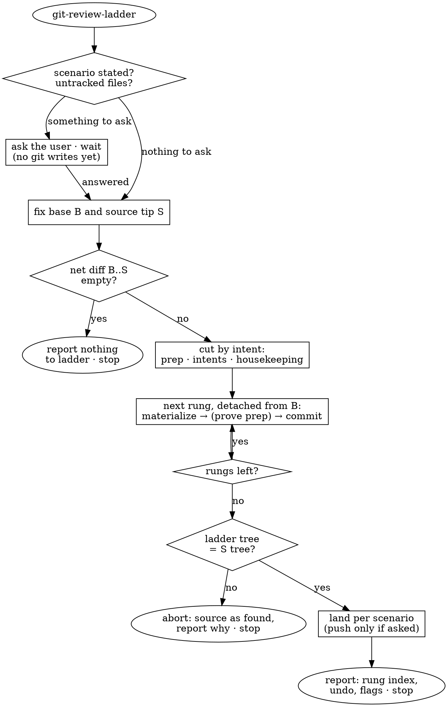

Re-tell a branch as a **review ladder**: its net diff re-cut into a few commits — **rungs** — that a human reviews one at a time, bottom up. A rung is one **intent**: one reason the change is in the PR, complete with the tests, docs, dependency and config it needs to be judged. The ladder is as long as the PR has intents, not files — a 150-line PR with three ideas is a handful of rungs. It ends on the same tree as its source: this skill moves lines between commits and writes no code. It stops when the ladder is built — reviewing the rungs is the user's job.



## Scenarios

| | **mine** | **theirs** |
|---|---|---|
| source | the checked-out branch | the named branch or PR, fetched (`gh pr checkout` for a PR) |
| uncommitted work | folded into the ladder: tracked changes always, each untracked file on the user's yes | is the user's, not the source's: a dirty tree → tell the user and stop |
| ladder lands | on the branch itself; the old tip is kept as `backup/<branch>-pre-ladder` | on a new branch `ladder/<branch>`; the source branch stays as found |
| push, when the user asked | `git push --force-with-lease` | `git push -u origin ladder/<branch>` |

## Pass

1. **Fix the scenario, the base, and the source.** Rewriting the wrong branch in place is the one costly mistake here, so the scenario comes from the invocation's own words or from the user's answer — authorship and branch names are not evidence. An unstated scenario, and in `mine` each untracked file, go to the user in one batch; every git write waits for the answer. With the user unreachable, the pass ends at the question.

   Resolve the base to a commit id first: the argument; else the PR's base branch; else `git symbolic-ref refs/remotes/origin/HEAD`; else `main`/`master`; else ask. `B` is its merge-base with the source tip. Then, in `mine` with a dirty tree, snapshot: commit the tracked changes and the approved untracked files as one commit on the branch. `S` is the source tip after that.

   Done when `B` and `S` are commit ids and `git diff B S` is exactly the change to ladder. An empty diff → report nothing to ladder and stop.

2. **Cut the net diff by intent.** Read `git diff B S` — the net diff, not the commits: how the journey sliced the change is the story the ladder replaces. Then ask of every changed line *why is this in the PR?* Lines that share an answer share a rung (Rungs, below), and every line lands in exactly one.

   - **An intent is complete.** Its tests, its docs, its dependency with the lockfile, its config ride in the same rung: the reviewer reads the claim and its evidence in one sitting.
   - **Cut at line level.** A line that both renames and changes logic appears twice — in prep with only the name changed, in its intent rung with the rest.
   - **Split an intent only where it is oversize and has a seam**: past 400 changed lines, a part that stands and makes sense alone (a helper the feature then uses) becomes the rung below. An oversize intent with no seam stays whole and is marked.
   - **Two intents never share a rung.** The test: could a reviewer accept one and reject the other?

   Done when every changed line of the net diff belongs to exactly one rung, and every rung's subject answers the *why*.

3. **Build rung by rung**, in the main working directory — the prep proof needs its installed dependencies. `git switch --detach B`, then for each rung in order:

   - **Materialize**: bring the working tree to `B` plus every rung so far. Take whole paths from the source (`git restore --source=S --staged --worktree -- <paths>`); edit files into the intermediate state where a path is split between rungs. Stage by path — declined untracked files are still in the tree. The last rung takes everything left, `git restore --source=S --staged --worktree -- :/`, so the end tree matches by construction.
   - **Prove** the prep rung before committing it (Rungs, below).
   - **Commit** with `--no-verify`: a rung's content is dictated by `S`, and a pre-commit hook that reformats or rejects an intermediate state would corrupt the ladder.

   Done when `git rev-parse HEAD^{tree}` equals `git rev-parse S^{tree}`. If they differ after the last rung, abort: switch back to the source branch, undo a snapshot with `git reset HEAD^` so the work returns to the tree, and report why.

4. **Land the ladder** per the scenario table. In `mine`: create the backup branch at `S` (name taken → append `S`'s short sha), then point the branch at the ladder tip and check it out. In `theirs`: `git switch -c ladder/<branch>`. Push only when the invocation asked for it.

5. **Report briefly.** The rung index (number and subject per rung), where the ladder landed, and flags: prep parts that lost their proof, oversize rungs, untracked files folded in. In `mine`, the undo: `git reset --hard backup/<branch>-pre-ladder`, plus `git reset HEAD^` if a snapshot was taken. Then stop.

## Rungs

Bottom to top:

| rung | holds | subject |
|---|---|---|
| **prep**, at most one, plus one per mass operation (below) | every behavior-preserving change with no meaning of its own: file moves with the import fix-ups they force, renames, reformatting, dead-code removal | `prep: <its parts>` |
| **intent**, one each | one reason the change is in the PR, complete | the intent as a plain sentence, in the repository's own commit style |
| **housekeeping**, at most one | small unrelated leftovers that deserve a glance each: a CI bump, a test for untouched code, a typo | `Housekeeping: <its parts>` |

**Subjects say what changes for the system or its user** — the sentence a reviewer would repeat when approving ("Retry failed uploads with doubling backoff"), where a file operation ("add retry.js and its test") says nothing a diff stat doesn't. Prep and housekeeping subjects name their parts; when the parts outgrow a subject line, summarize there and list them in the body.

**Prep earns its "skim".** Its proof: the project's own checks (tests, typecheck, build) pass at the prep rung as they did at `B`. A part that breaks them is not prep — it moves into the intent rung it belongs to. With no checks to run, the proof is the diff itself (`git diff --cached -w` empty for formatting; added lines equal to removed lines for a move) and the message says so. One mechanical operation that would bury the rest — a repo-wide reformat, a mass rename — takes a prep rung of its own, so its proof stands alone.

**Intent rungs run in dependency order** — each uses only what lower rungs introduced; independent intents go smallest first. A leftover that deserves real scrutiny (a migration, a risky config change) is an intent, not housekeeping.

## Rung message

```
<subject>

Verify: <the claims the reviewer checks on this rung>      intent and housekeeping rungs
Proof: <what ran → its result>                             the prep rung
Oversize: <why the rung has no seam>                       when marked
```

```
prep: move helpers into src/lib, rename fetchUser to loadUser

Proof: `npm test` → 12 pass at main and at this rung; no logic line changed.
```

```
Retry failed uploads with doubling backoff

Verify: three attempts in total, the wait doubles between them, and the last error is the one rethrown; retry.test.js pins the waits, upload.test.js the recovery. New dependency: ms.
```

Where the repository's `commit-msg` hook rejects the `prep:` subject (`git hook run --ignore-missing commit-msg -- <message file>`), write it in the repository's convention and open the body with `Prep rung.`
