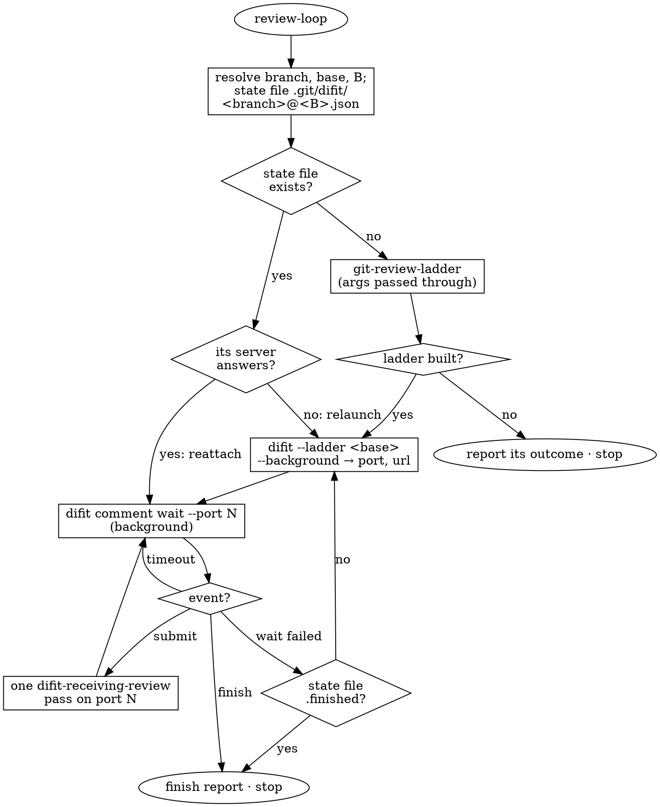

Drive a branch through review from first rung to Finish. The user reviews a **review ladder** (git-review-ladder) rung by rung in one `difit --ladder` session; each Submit wakes you for one difit-receiving-review pass, whose fixes land inside their rungs (`fixup!` + autosquash), and difit follows the rewritten branch by itself. The ladder is cut once, at the start, and never rebuilt. Needs both skills and a difit with `--ladder` ([HumanBean17/difit](https://github.com/HumanBean17/difit)).

## Pass

1. **Locate the session.** The branch is the one git-review-ladder lands on: the checked-out branch in `mine`, `ladder/<branch>` in `theirs`. Resolve the base the way git-review-ladder does (the argument; else the PR's base branch; else `origin/HEAD`; else `main`/`master`), then `B=$(git merge-base <base> <branch>)`. The state file is `$(git rev-parse --git-dir)/difit/<branch, "/" → "__">@<B>.json`.

   Done when you know whether that state file exists.

2. **Resume, or start.**

   - **The state file exists** — this review is in progress. Its `server` field names the difit that served it: `curl -sf <server.url>/api/session` answering with `"mode":"ladder"` → reattach on `server.port`. No answer → relaunch (below) — the threads, approvals and pending submits are in the state file, not in the server.
   - **No state file** — run git-review-ladder with this invocation's arguments, minus `push` (that applies to the end of the review). It may ask the user first; its questions are yours to relay. It ends without a ladder (nothing to ladder, aborted) → report its outcome and stop.

   **Launch** from the repository root: `difit --ladder <base> --background`, or `difit <branch> --ladder <base> --background` when the ladder's branch is not the checked-out one. It prints `{"port","url","pid"}`. Give the user the url once, with the keys that matter: `<` `>` step rungs, `a` approves, Cmd/Ctrl+Enter comments and submits, Finish ends the review.

   Done when a difit `--ladder` server answers on port `N`.

3. **Wait.** Run `difit comment wait --port N` as a background command where the harness has them (you are woken when it exits), else in the foreground with the longest timeout available. It prints one JSON event:

   - **`submit`** → step 4.
   - **`timeout`** → run it again.
   - **`finish`** → step 5.
   - **it fails** (server gone) → the state file renamed to `….json.finished` means the review finished → step 5; otherwise relaunch (step 2) and wait again.

   While it runs, the user is reviewing: stay quiet, and keep anything you say in chat short.

4. **Answer the submit** with exactly one difit-receiving-review pass on port `N`. The session is a ladder, so its fixes land in their rungs and difit reloads the rung under the user. Ambiguous threads still go to the user in chat, batched; keep waiting for the next Submit meanwhile — the answers arrive in chat, the comments in difit. Then back to step 3.

   Done when every thread the submit carried has an `agent` reply.

5. **Finish.** The finish event lists `unapprovedRungs` and `openThreads`. Report briefly:

   - the rung index: number, subject, approved or not;
   - flags: unapproved rungs, open threads, fixes that did not land (their thread replies say so);
   - in `mine`, the undo: `git reset --hard backup/<branch>-pre-ladder`;
   - push only when the invocation asked for it: `git push --force-with-lease` in `mine`, `git push -u origin ladder/<branch>` in `theirs`.

   Offer to delete the backup branch; delete it only on the user's yes. Then stop. The state file is set aside, so the next review-loop starts a fresh ladder.

## Rules

- The ladder is cut once. Fixes amend rungs; never re-run git-review-ladder on a branch whose state file exists.
- One difit per session: reattach before relaunching, and never launch a second server on a live one.
- A pass runs only on a submit event, never on a guess that the user is done.
- You never press Finish, resolve threads, or approve rungs — those are the user's, in difit.
